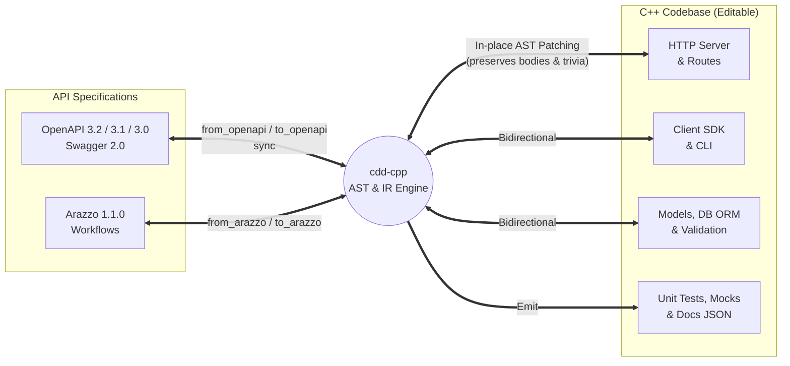

cdd-cpp: C++ ⇄ OpenAPI
======================

[](https://opensource.org/licenses/Apache-2.0)
[](https://offscale.io/wasm_web_demo)
[](https://github.com/SamuelMarks/cdd-cpp/actions/workflows/ci.yml)
[](#)
[](#)

**cdd-cpp** compiles **[OpenAPI](https://spec.openapis.org/oas/latest.html) / [Swagger](https://spec.openapis.org/oas/v2.0.html) / [Arazzo](https://spec.openapis.org/arazzo/latest.html)** to and from **C++** (servers, client SDKs, CLIs, database schemas, tests, mocks, and docs), updating your existing code in-place without overwriting your edits.

Write C++, emit OpenAPI. Or write OpenAPI, emit C++. Edit either side and `sync`—without losing your custom business logic, comments, or formatting.

---

## Why Compiler Driven Development (CDD)?

Traditional code generators are **one-way traps**: you generate a project once, add business logic, and can never regenerate without destroying your work. Meanwhile, hand-maintaining OpenAPI specs alongside code leads to Specification Drift.

**Compiler Driven Development (CDD)** treats API specifications and source code as two concrete syntaxes for the same underlying semantics:

1. **Bidirectional Compilation (`from_openapi` ⇄ `to_openapi`, `from_arazzo` ⇄ `to_arazzo`)**: Parse specs into an Intermediate Representation (IR) to emit idiomatic C++, or parse existing C++ ASTs (routes, models, docstrings, types, and workflow steps) to emit OpenAPI 3.2.0 and Arazzo 1.1.0.
2. **In-Place AST Synchronization (`sync`)**: Instead of overwriting files, `cdd-cpp` parses your existing source files into a trivia-preserving Abstract Syntax Tree (AST), merges parameter/route/schema changes, and writes back the file—keeping your function bodies, comments, and custom imports intact.
3. **Zero-Lock-In**: Stop using `cdd-cpp` at any time. The output is clean, human-readable, standard C++ with zero runtime dependency on `cdd-cpp` itself.
4. **Multi-Version OpenAPI & Arazzo Support**: Seamlessly ingest Swagger 2.0, OpenAPI 3.0, 3.1, 3.2.0, and Arazzo 1.1.0 workflows.



---

## Supported Capabilities

| Feature / Target | CLI Subcommand / Flag | Direction | Description |
| :--- | :--- | :---: | :--- |
| **Client SDK** | `from_openapi to_sdk` / `to_openapi` | **C++ ⇄ OpenAPI** | Strongly-typed HTTP client methods, request/response models, authentication helpers |
| **CLI Client** | `from_openapi to_sdk_cli` | **OpenAPI → C++** | Command-line interface wrapping the generated Client SDK with argument parsing |
| **Server & Routes** | `from_openapi to_server` / `to_openapi` | **C++ ⇄ OpenAPI** | Web framework route handlers, parameter binding, status codes, middleware hooks |
| **Models & DB / ORM** | `from_openapi` / `to_openapi` | **C++ ⇄ OpenAPI** | Data structures/classes, JSON serializers, validation constraints, database/ORM schemas |
| **Workflows (Arazzo)** | `from_arazzo` / `to_arazzo` | **C++ ⇄ Arazzo** | Multi-step API workflows, state propagation, step outputs, failure actions |
| **In-Place Sync** | `sync` | **C++ ⇄ OpenAPI** | AST-aware bidirectional synchronization preserving developer edits and formatting |
| **Documentation JSON** | `to_docs_json` | **OpenAPI → Docs** | Generates structured documentation & idiomatic C++ usage snippets per operation |
| **Tests & Mocks** | `--tests` | **OpenAPI → C++** | Generates unit tests and mock server/client harnesses |
| **MCP Server** | `mcp` | **JSON-RPC (stdio)** | Model Context Protocol server exposing `cdd-cpp` tools to AI agents & IDEs |
| **JSON-RPC Server** | `serve_json_rpc` | **JSON-RPC (HTTP/TCP)** | Long-running RPC daemon for IDE plugins and cross-language test harnesses |

---

## Installation & Setup

### Prerequisites

- **C++23 Compiler**: Clang 16+, GCC 13+, or MSVC 19.36+
- **CMake**: 3.15 or newer
- **libcurl**: Required for HTTP client transport (fetched or linked via CMake `find_package(CURL)`)
- **Python 3.10+**: Optional, used for coverage verification and pre-commit scripts
- **PostgreSQL (`libpq`)**: Optional, used when compiling generated servers with `--with-postgres`
- **WASI SDK / Emscripten**: Optional, used when targeting WebAssembly (`build_wasm`)

### Building from Source

```sh
cmake -B build -S . -DCMAKE_BUILD_TYPE=Release
cmake --build build -j4
```

This produces the standalone CLI executable `./build/cdd-cpp`, the static library `build/libcdd_lib.a`, and the test runner `./build/cdd-tests`.

### Integrating `cdd_lib` in CMake

To use `cdd-cpp` as a C++23 library in your own CMake project:

```cmake
add_subdirectory(cdd-cpp)
target_link_libraries(your_target PRIVATE cdd_lib)
```

### Local Development, Formatting & Verification

```sh
# Run the test suite
./build/cdd-tests

# Check 100% Doxygen documentation coverage
python3 tools/doc_coverage.py --verbose

# Check 100% line, function, and branch test coverage
python3 tools/test_coverage.py

# Run all pre-commit checks (format, build, tests, coverage, WASM, Docker)
python3 scripts/run_pre_commit_checks.py
```

---

## Usage

### Quickstart Workflow

```sh
# 1. Generate a C++ client SDK from an OpenAPI spec
cdd-cpp from_openapi to_sdk -i petstore.json -o ./src/client

# 2. Generate a C++ server with routes, models, and tests
cdd-cpp from_openapi to_server -i petstore.json -o ./src/server --tests

# 3. Edit ./src/server in your IDE (add business logic, modify parameters or docstrings),
#    then extract an updated OpenAPI 3.2.0 spec directly from your C++ code:
cdd-cpp to_openapi -i ./src/server -o petstore.updated.json

# 4. Synchronize an existing project directory with a spec in-place:
cdd-cpp sync -i ./src/server -o petstore.json

# 5. Generate multi-step workflow runners from an Arazzo 1.1.0 spec:
cdd-cpp from_arazzo to_sdk -i workflows.arazzo.json -o ./src/workflows
cdd-cpp to_arazzo -i ./src/workflows -o workflows.updated.arazzo.json

# 6. Emit multi-language documentation snippet JSON for API portals:
cdd-cpp to_docs_json -i petstore.json -o docs.json
```

### Core CLI Subcommands & `--help` Output

#### `cdd-cpp --help`

```text
CDD CLI (Code-Driven Development)
Usage:
  cdd-cpp --help
  cdd-cpp --version
  cdd-cpp to_openapi -i <path/to/code> [-o <spec.json>]
  cdd-cpp from_openapi to_sdk_cli -i <spec.json> -o <target_directory> [--no-github-actions] [--no-installable-package] [--tests]
  cdd-cpp from_openapi to_sdk_cli --input-dir <specs_dir> -o <target_directory> [--no-github-actions] [--no-installable-package] [--tests]
  cdd-cpp from_openapi to_sdk -i <spec.json> -o <target_directory> [--no-github-actions] [--no-installable-package] [--tests]
  cdd-cpp from_openapi to_sdk --input-dir <specs_dir> -o <target_directory> [--no-github-actions] [--no-installable-package] [--tests]
  cdd-cpp from_openapi to_server -i <spec.json> -o <target_directory> [--no-github-actions] [--no-installable-package] [--tests] [--with-postgres] [--with-faker]
  cdd-cpp from_openapi to_server --input-dir <specs_dir> -o <target_directory> [--no-github-actions] [--no-installable-package] [--tests] [--with-postgres] [--with-faker]
  cdd-cpp from_arazzo to_sdk -i <spec.arazzo.json> -o <target_directory> [--no-github-actions] [--no-installable-package] [--tests]
  cdd-cpp from_arazzo to_sdk_cli -i <spec.arazzo.json> -o <target_directory> [--no-github-actions] [--no-installable-package] [--tests]
  cdd-cpp from_arazzo to_server -i <spec.arazzo.json> -o <target_directory> [--no-installable-package] [--tests]
  cdd-cpp to_arazzo -i <path/to/code> [-o <spec.arazzo.json>]
  cdd-cpp from_google_discovery to_sdk_cli -i <discovery.json> -o <target_directory> [--no-github-actions] [--no-installable-package] [--tests]
  cdd-cpp from_google_discovery to_sdk -i <discovery.json> -o <target_directory> [--no-github-actions] [--no-installable-package] [--tests]
  cdd-cpp to_docs_json [--no-imports] [--no-wrapping] -i <spec.json> [-o <docs.json>]
  cdd-cpp serve_json_rpc [-p|--port <port>] [-l|--listen <address>]
  cdd-cpp sync -i <dir> -o <file> [-t|--truth <code|spec>]
  cdd-cpp mcp

Commands:
  from_openapi : Generate code from an OpenAPI specification.
  to_openapi   : Generate an OpenAPI specification from source code.
  from_arazzo  : Generate code from an Arazzo 1.1.0 specification.
  to_arazzo    : Generate an Arazzo 1.1.0 specification from source code.
  to_docs_json : Generate JSON documentation with code snippets for an OpenAPI specification.
  serve_json_rpc: Expose CLI interface as JSON-RPC server.
  from_google_discovery: Generate code from a Google Discovery JSON.
  sync         : Synchronize an OpenAPI specification with source code.
  mcp          : Start a Model Context Protocol (MCP) STDIO server.

Options:
  -i, --input                         Path or URL to the OpenAPI/Arazzo specification or source directory.
  -d, --input-dir                 Directory containing OpenAPI specifications.
  -o, --output                    Output file or directory path.
  -t, --truth                     Source of truth (code or spec) when syncing.
  -m, --mcp                       Generate MCP server.
      --tests                     Generate integration tests and mocks.
      --with-postgres             Generate PostgreSQL libpq ORM models.
      --with-faker                Generate Faker mock data helpers.
      --no-github-actions         Do not generate GitHub Actions scaffolding.
      --no-installable-package    Do not generate installable package scaffolding.
      --no-imports                Omit the imports field.
      --no-wrapping               Omit the wrapper fields.
  -p, --port                      Port to listen on (serve_json_rpc).
  -l, --listen                    Address to listen on (serve_json_rpc).
  -h, --help                      Show this help message.
  -v, --version                   Show version information.
```

#### `cdd-cpp from_openapi --help`

```text
Usage:
  cdd-cpp from_openapi to_sdk_cli -i <spec.json> -o <target_directory> [--no-github-actions] [--no-installable-package] [--tests]
  cdd-cpp from_openapi to_sdk_cli --input-dir <specs_dir> -o <target_directory> [--no-github-actions] [--no-installable-package] [--tests]
  cdd-cpp from_openapi to_sdk -i <spec.json> -o <target_directory> [--no-github-actions] [--no-installable-package] [--tests]
  cdd-cpp from_openapi to_sdk --input-dir <specs_dir> -o <target_directory> [--no-github-actions] [--no-installable-package] [--tests]
  cdd-cpp from_openapi to_server -i <spec.json> -o <target_directory> [--no-github-actions] [--no-installable-package] [--tests] [--with-postgres] [--with-faker]
  cdd-cpp from_openapi to_server --input-dir <specs_dir> -o <target_directory> [--no-github-actions] [--no-installable-package] [--tests] [--with-postgres] [--with-faker]

Options:
  -i, --input                         Path or URL to the OpenAPI specification.
  -d, --input-dir                 Directory containing OpenAPI specifications.
  -o, --output                    Output file or directory path.
  -m, --mcp                       Generate MCP server.
      --tests                     Generate integration tests and mocks.
      --with-postgres             Generate PostgreSQL libpq ORM models.
      --with-faker                Generate Faker mock data helpers.
      --no-github-actions         Do not generate GitHub Actions scaffolding.
      --no-installable-package    Do not generate installable package scaffolding.
```

#### `cdd-cpp from_openapi to_sdk --help`

```text
Usage:
  cdd-cpp from_openapi to_sdk_cli -i <spec.json> -o <target_directory> [--no-github-actions] [--no-installable-package] [--tests]
  cdd-cpp from_openapi to_sdk_cli --input-dir <specs_dir> -o <target_directory> [--no-github-actions] [--no-installable-package] [--tests]
  cdd-cpp from_openapi to_sdk -i <spec.json> -o <target_directory> [--no-github-actions] [--no-installable-package] [--tests]
  cdd-cpp from_openapi to_sdk --input-dir <specs_dir> -o <target_directory> [--no-github-actions] [--no-installable-package] [--tests]
  cdd-cpp from_openapi to_server -i <spec.json> -o <target_directory> [--no-github-actions] [--no-installable-package] [--tests] [--with-postgres] [--with-faker]
  cdd-cpp from_openapi to_server --input-dir <specs_dir> -o <target_directory> [--no-github-actions] [--no-installable-package] [--tests] [--with-postgres] [--with-faker]

Options:
  -i, --input                         Path or URL to the OpenAPI specification.
  -d, --input-dir                 Directory containing OpenAPI specifications.
  -o, --output                    Output file or directory path.
  -m, --mcp                       Generate MCP server.
      --tests                     Generate integration tests and mocks.
      --with-postgres             Generate PostgreSQL libpq ORM models.
      --with-faker                Generate Faker mock data helpers.
      --no-github-actions         Do not generate GitHub Actions scaffolding.
      --no-installable-package    Do not generate installable package scaffolding.
```

#### `cdd-cpp from_openapi to_sdk_cli --help`

```text
Usage:
  cdd-cpp from_openapi to_sdk_cli -i <spec.json> -o <target_directory> [--no-github-actions] [--no-installable-package] [--tests]
  cdd-cpp from_openapi to_sdk_cli --input-dir <specs_dir> -o <target_directory> [--no-github-actions] [--no-installable-package] [--tests]
  cdd-cpp from_openapi to_sdk -i <spec.json> -o <target_directory> [--no-github-actions] [--no-installable-package] [--tests]
  cdd-cpp from_openapi to_sdk --input-dir <specs_dir> -o <target_directory> [--no-github-actions] [--no-installable-package] [--tests]
  cdd-cpp from_openapi to_server -i <spec.json> -o <target_directory> [--no-github-actions] [--no-installable-package] [--tests] [--with-postgres] [--with-faker]
  cdd-cpp from_openapi to_server --input-dir <specs_dir> -o <target_directory> [--no-github-actions] [--no-installable-package] [--tests] [--with-postgres] [--with-faker]

Options:
  -i, --input                         Path or URL to the OpenAPI specification.
  -d, --input-dir                 Directory containing OpenAPI specifications.
  -o, --output                    Output file or directory path.
  -m, --mcp                       Generate MCP server.
      --tests                     Generate integration tests and mocks.
      --with-postgres             Generate PostgreSQL libpq ORM models.
      --with-faker                Generate Faker mock data helpers.
      --no-github-actions         Do not generate GitHub Actions scaffolding.
      --no-installable-package    Do not generate installable package scaffolding.
```

#### `cdd-cpp from_openapi to_server --help`

```text
Usage:
  cdd-cpp from_openapi to_sdk_cli -i <spec.json> -o <target_directory> [--no-github-actions] [--no-installable-package] [--tests]
  cdd-cpp from_openapi to_sdk_cli --input-dir <specs_dir> -o <target_directory> [--no-github-actions] [--no-installable-package] [--tests]
  cdd-cpp from_openapi to_sdk -i <spec.json> -o <target_directory> [--no-github-actions] [--no-installable-package] [--tests]
  cdd-cpp from_openapi to_sdk --input-dir <specs_dir> -o <target_directory> [--no-github-actions] [--no-installable-package] [--tests]
  cdd-cpp from_openapi to_server -i <spec.json> -o <target_directory> [--no-github-actions] [--no-installable-package] [--tests] [--with-postgres] [--with-faker]
  cdd-cpp from_openapi to_server --input-dir <specs_dir> -o <target_directory> [--no-github-actions] [--no-installable-package] [--tests] [--with-postgres] [--with-faker]

Options:
  -i, --input                         Path or URL to the OpenAPI specification.
  -d, --input-dir                 Directory containing OpenAPI specifications.
  -o, --output                    Output file or directory path.
  -m, --mcp                       Generate MCP server.
      --tests                     Generate integration tests and mocks.
      --with-postgres             Generate PostgreSQL libpq ORM models.
      --with-faker                Generate Faker mock data helpers.
      --no-github-actions         Do not generate GitHub Actions scaffolding.
      --no-installable-package    Do not generate installable package scaffolding.
```

#### `cdd-cpp to_openapi --help`

```text
Usage:
  cdd-cpp to_openapi -i <path/to/code> [-o <spec.json>]

Options:
  -i, --input                         Path to source code directory or file.
  -o, --output                    Output file or directory path.
```

#### `cdd-cpp from_arazzo --help`

```text
Usage:
  cdd-cpp from_arazzo to_sdk -i <spec.arazzo.json> -o <target_directory> [--no-github-actions] [--no-installable-package] [--tests]
  cdd-cpp from_arazzo to_sdk_cli -i <spec.arazzo.json> -o <target_directory> [--no-github-actions] [--no-installable-package] [--tests]
  cdd-cpp from_arazzo to_server -i <spec.arazzo.json> -o <target_directory> [--no-installable-package] [--tests]

Options:
  -i, --input                         Path to the Arazzo 1.1.0 specification.
  -o, --output                    Output directory path.
      --tests                     Generate integration tests and mocks.
      --no-github-actions         Do not generate GitHub Actions scaffolding.
      --no-installable-package    Do not generate installable package scaffolding.
```

#### `cdd-cpp from_arazzo to_sdk --help`

```text
Usage:
  cdd-cpp from_arazzo to_sdk -i <spec.arazzo.json> -o <target_directory> [--no-github-actions] [--no-installable-package] [--tests]
  cdd-cpp from_arazzo to_sdk_cli -i <spec.arazzo.json> -o <target_directory> [--no-github-actions] [--no-installable-package] [--tests]
  cdd-cpp from_arazzo to_server -i <spec.arazzo.json> -o <target_directory> [--no-installable-package] [--tests]

Options:
  -i, --input                         Path to the Arazzo 1.1.0 specification.
  -o, --output                    Output directory path.
      --tests                     Generate integration tests and mocks.
      --no-github-actions         Do not generate GitHub Actions scaffolding.
      --no-installable-package    Do not generate installable package scaffolding.
```

#### `cdd-cpp from_arazzo to_sdk_cli --help`

```text
Usage:
  cdd-cpp from_arazzo to_sdk -i <spec.arazzo.json> -o <target_directory> [--no-github-actions] [--no-installable-package] [--tests]
  cdd-cpp from_arazzo to_sdk_cli -i <spec.arazzo.json> -o <target_directory> [--no-github-actions] [--no-installable-package] [--tests]
  cdd-cpp from_arazzo to_server -i <spec.arazzo.json> -o <target_directory> [--no-installable-package] [--tests]

Options:
  -i, --input                         Path to the Arazzo 1.1.0 specification.
  -o, --output                    Output directory path.
      --tests                     Generate integration tests and mocks.
      --no-github-actions         Do not generate GitHub Actions scaffolding.
      --no-installable-package    Do not generate installable package scaffolding.
```

#### `cdd-cpp from_arazzo to_server --help`

```text
Usage:
  cdd-cpp from_arazzo to_sdk -i <spec.arazzo.json> -o <target_directory> [--no-github-actions] [--no-installable-package] [--tests]
  cdd-cpp from_arazzo to_sdk_cli -i <spec.arazzo.json> -o <target_directory> [--no-github-actions] [--no-installable-package] [--tests]
  cdd-cpp from_arazzo to_server -i <spec.arazzo.json> -o <target_directory> [--no-installable-package] [--tests]

Options:
  -i, --input                         Path to the Arazzo 1.1.0 specification.
  -o, --output                    Output directory path.
      --tests                     Generate integration tests and mocks.
      --no-github-actions         Do not generate GitHub Actions scaffolding.
      --no-installable-package    Do not generate installable package scaffolding.
```

#### `cdd-cpp to_arazzo --help`

```text
Usage:
  cdd-cpp to_arazzo -i <path/to/code> [-o <spec.arazzo.json>]

Options:
  -i, --input                         Path to source code directory or file.
  -o, --output                    Output file or directory path.
```

#### `cdd-cpp sync --help`

```text
Usage:
  cdd-cpp sync -i <dir> -o <file> [-t|--truth <code|spec>]

Options:
  -i, --input                         Path to source code directory.
  -o, --output                    Path to OpenAPI spec file.
  -t, --truth                     Source of truth (code or spec).
```

#### `cdd-cpp to_docs_json --help`

```text
Usage:
  cdd-cpp to_docs_json [--no-imports] [--no-wrapping] -i <spec.json> [-o <docs.json>]

Options:
  -i, --input                         Path or URL to the OpenAPI specification.
  -o, --output                    Output file or directory path.
      --no-imports                Omit the imports field.
      --no-wrapping               Omit the wrapper fields.
```

#### `cdd-cpp serve_json_rpc --help`

```text
Usage:
  cdd-cpp serve_json_rpc [-p|--port <port>] [-l|--listen <address>]

Options:
  -p, --port                      Port to listen on.
  -l, --listen                    Address to listen on.
```

#### `cdd-cpp mcp --help`

```text
Usage:
  cdd-cpp mcp

Start a Model Context Protocol (MCP) STDIO server.
```

#### `cdd-cpp from_google_discovery --help`

```text
Usage:
  cdd-cpp from_google_discovery to_sdk_cli -i <discovery.json> -o <target_directory> [--no-github-actions] [--no-installable-package] [--tests]
  cdd-cpp from_google_discovery to_sdk -i <discovery.json> -o <target_directory> [--no-github-actions] [--no-installable-package] [--tests]

Options:
  -i, --input                         Path to the Google Discovery specification.
  -o, --output                    Output directory path.
      --tests                     Generate integration tests and mocks.
      --no-github-actions         Do not generate GitHub Actions scaffolding.
      --no-installable-package    Do not generate installable package scaffolding.
```

#### `cdd-cpp from_google_discovery to_sdk --help`

```text
Usage:
  cdd-cpp from_google_discovery to_sdk_cli -i <discovery.json> -o <target_directory> [--no-github-actions] [--no-installable-package] [--tests]
  cdd-cpp from_google_discovery to_sdk -i <discovery.json> -o <target_directory> [--no-github-actions] [--no-installable-package] [--tests]

Options:
  -i, --input                         Path to the Google Discovery specification.
  -o, --output                    Output directory path.
      --tests                     Generate integration tests and mocks.
      --no-github-actions         Do not generate GitHub Actions scaffolding.
      --no-installable-package    Do not generate installable package scaffolding.
```

#### `cdd-cpp from_google_discovery to_sdk_cli --help`

```text
Usage:
  cdd-cpp from_google_discovery to_sdk_cli -i <discovery.json> -o <target_directory> [--no-github-actions] [--no-installable-package] [--tests]
  cdd-cpp from_google_discovery to_sdk -i <discovery.json> -o <target_directory> [--no-github-actions] [--no-installable-package] [--tests]

Options:
  -i, --input                         Path to the Google Discovery specification.
  -o, --output                    Output directory path.
      --tests                     Generate integration tests and mocks.
      --no-github-actions         Do not generate GitHub Actions scaffolding.
      --no-installable-package    Do not generate installable package scaffolding.
```

---

### Library / SDK Usage

```cpp
#include "arazzo/emit.hpp"
#include "arazzo/expressions.hpp"
#include "arazzo/parse.hpp"
#include "client_sdk/emit.hpp"
#include "client_sdk/parse.hpp"
#include "client_sdk_cli/emit.hpp"
#include "mocks/emit.hpp"
#include "models/emit.hpp"
#include "openapi/emit.hpp"
#include "openapi/parse.hpp"
#include "openapi/upgraders/upgrader.hpp"
#include "orm/emit.hpp"
#include "server/emit.hpp"
#include "utils/cpp_parser.hpp"
#include <cassert>
#include <string>

int main() {
  // 1. Upgrade any Swagger 2.0 / OpenAPI 3.0 / 3.1 / 3.2 JSON to OpenAPI 3.2.0
  const std::string raw_spec = R"({
    "openapi": "3.2.0",
    "info": { "title": "Petstore API", "version": "1.0.0" },
    "paths": {
      "/pets": {
        "get": {
          "operationId": "listPets",
          "responses": { "200": { "description": "OK" } }
        }
      }
    }
  })";

  auto upgraded = cdd_cpp::openapi::upgraders::upgrade_to_latest(raw_spec);
  assert(upgraded.has_value());

  auto parsed = cdd_cpp::openapi::parse(*upgraded);
  assert(parsed.has_value());
  const cdd_cpp::openapi::OpenAPI &spec = *parsed;

  // 2. Emit C++ Client SDK, CLI, HTTP Server, PostgreSQL/Faker ORM, Models, and GoogleMocks
  auto sdk_files = cdd_cpp::client_sdk::emit_client(spec, false, false, true);
  auto cli_files = cdd_cpp::client_sdk_cli::emit_cli(spec, false, false, true);
  auto srv_files = cdd_cpp::server::emit_modular(spec, false, true, true, true);
  auto orm_files = cdd_cpp::orm::emit_modular(spec, true, true);
  auto model_files = cdd_cpp::models::emit_modular(spec);
  std::string gmock_header = cdd_cpp::mocks::emit(spec);

  // 3. Reverse-parse emitted C++ Client SDK or project directory back to OpenAPI 3.2.0
  auto roundtrip_spec = cdd_cpp::client_sdk::parse(sdk_files.at("src/client.hpp"));
  assert(roundtrip_spec.has_value());
  std::string openapi_json = cdd_cpp::openapi::emit(*roundtrip_spec);

  // 4. Parse & emit Arazzo 1.1.0 multi-step workflows and evaluate runtime expressions
  const std::string raw_arazzo = R"({
    "arazzo": "1.1.0",
    "info": { "title": "Petstore Workflow", "version": "1.0.0" },
    "sourceDescriptions": [{ "name": "petstore", "url": "./petstore.json", "type": "openapi" }],
    "workflows": [{
      "workflowId": "adoptPet",
      "steps": [{ "stepId": "findPet", "operationId": "listPets" }]
    }]
  })";

  auto arazzo_res = cdd_cpp::arazzo::parse(raw_arazzo);
  assert(arazzo_res.has_value());
  auto workflow_sdk = cdd_cpp::client_sdk::emit_arazzo_client(*arazzo_res, spec);
  std::string arazzo_json = cdd_cpp::arazzo::emit(*arazzo_res);

  return 0;
}
```

---

## Special Features Beyond the Common Compiler Driven Development Subset

- **Google Discovery API Compiler (`from_google_discovery`)**: Directly parses Google Discovery JSON documents and multi-API Discovery directory manifests (`cdd_cpp::google_discovery::parse`) into OpenAPI 3.2.0 ASTs and emits complete C++ Client SDKs (`to_sdk`) and CLI applications (`to_sdk_cli`).
- **PostgreSQL (`libpq`) & Faker ORM/DAO Generation (`--with-postgres`, `--with-faker`)**: `from_openapi to_server` and `cdd_cpp::orm::emit_modular` generate SQL DDL schemas (`migrations/init.sql`), abstract `I<Model>Dao` interfaces, `Postgres<Model>Dao` implementations backed by native `libpq` parameterized queries (`PGconn`, `PQexecParams`), `Stub<Model>Dao` in-memory/Faker-seeded mock repositories, and `RepositoryFactory` wiring. Generated server binaries support `--ephemeral` (ephemeral PostgreSQL schemas), `--seed <N>` (startup data seeding), `--seed-random` (non-deterministic `std::random_device` entropy), and `--seed-value <uint64>` (deterministic PRNG seeding), alongside RFC 7807 `application/problem+json` request validation middleware, an embedded OAuth2/OIDC Identity Provider (`/.well-known/openid-configuration`, `/.well-known/jwks.json`, `/oauth/authorize`, `/oauth/token`), and an administrative webhook dispatcher (`/_mock/trigger-webhook`).
- **Multi-Version OpenAPI & Swagger Upgrader (`cdd_cpp::openapi::upgraders::upgrade_to_latest`)**: Automatically detects and upgrades Swagger 1.2, Swagger 2.0, OpenAPI 3.0.x, and OpenAPI 3.1.x documents to OpenAPI 3.2.0 prior to parsing—converting `host`/`basePath`/`schemes` to `servers`, `definitions` to `components.schemas`, `securityDefinitions` to `components.securitySchemes`, `in: body`/`formData` to `requestBody`, and `x-webhooks` to `webhooks`.
- **Arazzo 1.1.0 Runtime Expression Engine & Criterion Evaluator (`cdd_cpp::arazzo`)**: Full ABNF runtime expression parser (`parse_runtime_expression`) and evaluator (`evaluate_expression`) supporting `$url`, `$method`, `$statusCode`, `$request.*`, `$response.*`, `$inputs.*`, `$outputs.*`, `$steps.*`, `$workflows.*`, `$sourceDescriptions.*`, `$components.*`, and `$self`, plus RFC 6901 JSON Pointer resolution (`evaluate_json_pointer`), `{$...}` template interpolation (`interpolate_template`), dynamic payload replacements (`apply_payload_replacement`), and `Criterion` condition evaluation (`simple`, `regex`, `jsonpath` RFC 9535 / Goessner draft, and `xpath` 1.0/2.0/3.0).
- **Complete Model Context Protocol (`2024-11-05`) Suite & `-m` / `--mcp` Generator (`cdd_cpp::mcp`)**: Provides strongly typed C++23 structures, `simdjson` parsers, and `JsonWriter` emitters for every MCP `2024-11-05` request, result, notification, content block, and capability; includes a built-in STDIO MCP server (`cdd-cpp mcp`) exposing `from_openapi`, `to_openapi`, `sync`, and `cdd_generate` (`from_arazzo` / `to_arazzo`), plus the `-m` / `--mcp` flag on `from_openapi` to emit standalone MCP server projects from any OpenAPI spec.
- **Trivia-Preserving C++ AST & Doxygen Docstring Round-Tripping (`cdd_cpp::utils::CppAST` & `cdd_cpp::docstrings`)**: Custom zero-dependency C++23 lexer/AST engine (`parse_cpp` / `emit_cpp`) that preserves leading and trailing whitespace/comment `Trivia` alongside structured Doxygen `@tag` annotations (`@title`, `@version`, `@servers`, `@securitySchemes`, `@operationId`, `@tags`, `@param`, `@response_content`, `@arazzo`, `@workflowId`, `@workflow_json`), enabling lossless bidirectional `sync` with configurable source of truth (`-t|--truth <code|spec>`).
- **Bidirectional GoogleMock & GoogleTest Generation (`--tests`, `cdd_cpp::mocks`)**: Emits and reverse-parses GoogleMock `IClient` / `MockClient` (`MOCK_METHOD`) headers for OpenAPI operations and `IWorkflows` / `MockWorkflows` headers for Arazzo workflows, alongside executable GoogleTest suites.
- **Environment Variable Fallbacks for CI/CD Pipelines**: All CLI subcommands accept environment variable fallbacks (`CDD_INPUT`, `CDD_INPUT_DIR`, `CDD_OUTPUT`, `CDD_TRUTH`, `CDD_PORT`, `CDD_LISTEN`, `CDD_NO_GITHUB_ACTIONS`, `CDD_NO_INSTALLABLE_PACKAGE`, `CDD_TESTS`, `CDD_NO_IMPORTS`, `CDD_NO_WRAPPING`).
- **WebAssembly (`wasi-sdk` & Emscripten) Support**: Compiles cleanly to standalone WebAssembly (`cdd-cpp.wasm`) via `wasi-sdk` (`-DWASI=ON`) or Emscripten (`emcmake cmake`) with portable WASI filesystem and HTTP shims.

---

## Ecosystem & Related Projects

`cdd-cpp` is part of the **Offscale Compiler Driven Development (CDD)** ecosystem. Every implementation shares the same core CLI subcommands, JSON-RPC interface, and MCP protocol support:

| Project | Target Language | Bidirectional Targets |
| :--- | :--- | :--- |
| **[cdd-c](https://github.com/offscale/cdd-c)** | C (C89 up to C29) | Server, Client SDK, CLI, Models, ORM, Mocks |
| **[cdd-cpp](https://github.com/offscale/cdd-cpp)** | C++ (C++23) | Server, Client SDK, CLI, Models, ORM, Mocks |
| **[cdd-csharp](https://github.com/offscale/cdd-csharp)** | C# (.NET) | ASP.NET Minimal APIs, HttpClient SDK, CLI, EF Core |
| **[cdd-go](https://github.com/offscale/cdd-go)** | Go | `net/http` / Gin / Echo, Client SDK, CLI, GORM |
| **[cdd-java](https://github.com/offscale/cdd-java)** | Java | Spring Boot / Jakarta, HttpClient SDK, CLI, JPA |
| **[cdd-kotlin](https://github.com/offscale/cdd-kotlin)** | Kotlin | Ktor / Spring, Ktor Client SDK, CLI, Exposed |
| **[cdd-php](https://github.com/offscale/cdd-php)** | PHP | Laravel / Symfony / Slim, Guzzle SDK, CLI, Eloquent |
| **[cdd-python-all](https://github.com/offscale/cdd-python-all)** | Python | FastAPI / Flask / Django, Requests/HTTPX SDK, SQLAlchemy |
| **[cdd-ruby](https://github.com/offscale/cdd-ruby)** | Ruby | Rails / Sinatra, Faraday/Net::HTTP SDK, CLI, ActiveRecord |
| **[cdd-rust](https://github.com/offscale/cdd-rust)** | Rust | Actix / Axum, Reqwest SDK, Clap CLI, SeaORM / Diesel |
| **[cdd-scala](https://github.com/offscale/cdd-scala)** | Scala (Scala 3) | Http4s / Tapir, Sttp Client SDK, CLI, Slick / Doobie |
| **[cdd-sh](https://github.com/offscale/cdd-sh)** | Shell (POSIX / Bash / Zsh) | `curl` + `jq` Client SDK, CLI, Shell Server |
| **[cdd-swift](https://github.com/offscale/cdd-swift)** | Swift | Vapor / Hummingbird, URLSession SDK, ArgumentParser CLI, Fluent |
| **[cdd-ts](https://github.com/offscale/cdd-ts)** | TypeScript / JavaScript | Express / Fastify / Hono, Fetch SDK, CLI, Prisma / TypeORM |
| **[cdd-ctl](https://github.com/offscale/cdd-ctl)** | Multi-Language Orchestrator | Unified CLI, WASM runtime manager, and test harness |

### Standardized Build Targets

Across all `cdd-*` repositories, root `Makefile` and `make.bat` scripts provide consistent targets:

```sh
make deps
make build
make test
# or on Windows:
.\make.bat deps
.\make.bat build
.\make.bat test
```

---

## License

Licensed under either of

- Apache License, Version 2.0 ([LICENSE-APACHE](LICENSE-APACHE) or <https://www.apache.org/licenses/LICENSE-2.0>)
- MIT license ([LICENSE-MIT](LICENSE-MIT) or <https://opensource.org/licenses/MIT>)

at your option.

### Contribution

Unless you explicitly state otherwise, any contribution intentionally submitted
for inclusion in the work by you, as defined in the Apache-2.0 license, shall be
dual licensed as above, without any additional terms or conditions.
